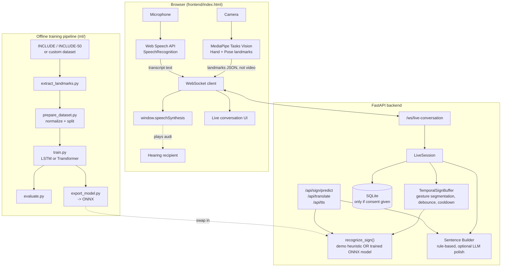

# SignBridge — Architecture

## System overview



## Design principle: recognition is replaceable

`backend/sign_language/recognizer.py` exposes exactly one function:

```python
recognize_sign(sequence) -> {"sign": str, "confidence": float, "model": "demo"|"production"}
```

Everything else in the app (temporal buffer, WebSocket handler, sentence
builder, REST API) depends only on this function's contract, never on how
it's implemented. Today it's backed by `HeuristicSignClassifier` (geometric
rules over hand shape). Once you have a trained model exported via
`ml/training/export_model.py`, set `DEMO_MODE=false` and it's backed by
`TrainedSignClassifier` (ONNX Runtime) instead — no other file changes.

## Why landmarks, not video, cross the network

Camera frames are processed by MediaPipe entirely inside the browser (WASM).
Only the extracted landmark coordinates (a few hundred floats per frame) are
sent over the WebSocket. This satisfies three requirements at once:
low bandwidth/latency (§18), no raw video leaving the device by default
(§15 privacy), and a smaller attack surface (nothing to intercept but
numbers).

## Two-way flow, not a one-way pipe

The WebSocket carries both directions concurrently on one connection:
`landmarks` messages flow browser → backend → (sign → sentence → speak)
→ browser; `speech_text` messages flow browser (Web Speech API) → backend
→ browser (displayed to signer). Both share one `LiveSession`/`session_id`,
so a future version can interleave them into a single conversation
transcript.

## Known simplification in this prototype (documented, not hidden)

The current "end of utterance" policy in `live_conversation.py` builds and
speaks a sentence after **every single confirmed sign** rather than waiting
for a longer pause that would indicate the signer finished a full thought.
This was a deliberate MVP simplification: with only ~21 demo signs and a
heuristic classifier, reliably detecting "the user paused because they're
done" vs. "the user paused between two signs" needs more signal than the
demo model provides. `UTTERANCE_GAP_SIGNS` and the comment above it in that
file mark exactly where to add a real pause-based end-of-utterance
detector once the recognition model is more capable.
